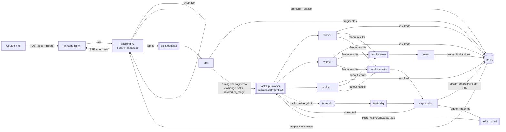
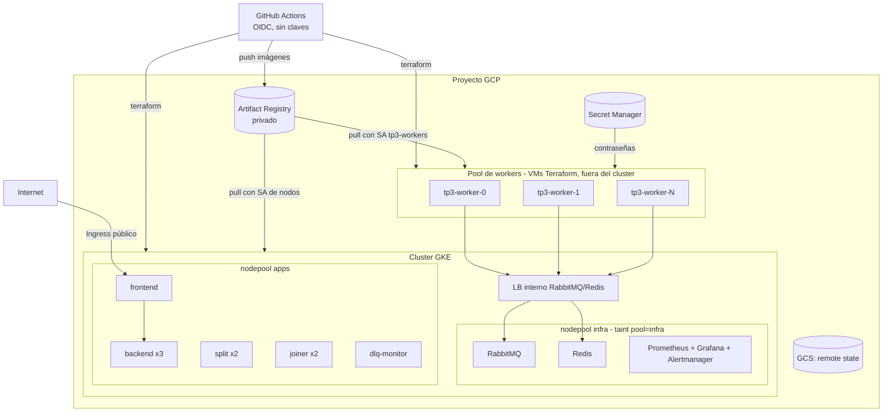

# Arquitectura

## Flujo de un job

## Despliegue en GKE (Hit #3)

## Decisiones de diseño
- **Redis como almacén de fragmentos**: por el broker solo viajan mensajes chicos (JSON con referencias) y los bytes van por Redis. Así RabbitMQ no se satura con mensajes de 100 MB.
- **Solapamiento al partir**: cada operación 3×3 necesita 1 px de vecinos, así que una cadena de k operaciones necesita k px. Sin ese solapamiento aparecen líneas en las uniones. Lo verifica `test_split_process_join_equals_full_image`.
- **Sin normalización por el máximo** en Sobel (se recorta a 255). Si cada fragmento normalizara por su propio máximo, los fragmentos no quedarían consistentes entre sí.
- **Idempotencia del joiner**: `SADD` de `fragment_id` y `SET NX` del lock de armado. Los resultados duplicados por reentregas no rompen nada y con varias réplicas del joiner solo una arma la imagen.
- **404 en lugar de 403** cuando un usuario consulta un job ajeno, para no revelar que el job existe.
- TODO (C): diagrama de arquitectura híbrida del Hit #2, con la justificación local o nube de cada servicio, en [hit2/README.md](../hit2/README.md).
