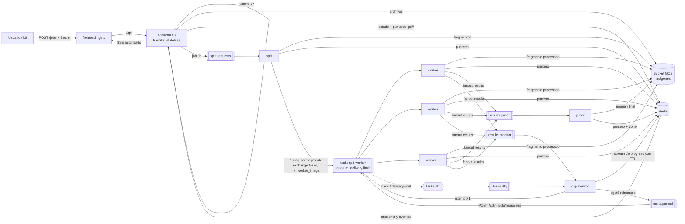
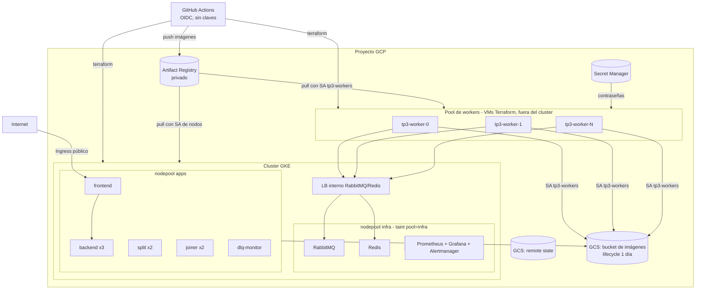

# Arquitectura

## Flujo de un job

## Despliegue en GKE (Hit #3)

## Decisiones de diseño
- **Imágenes en un bucket, punteros en Redis**: por el broker solo viajan mensajes chicos (JSON con el puntero `gs://...` del fragmento) y los bytes van a un bucket de GCS (`<proyecto>-tp3-images`). Redis guarda únicamente estado y punteros (~80 bytes por clave). Antes los bytes iban a Redis y la memoria crecía con el tamaño de los archivos: con carga sostenida el pod terminó `OOMKilled` (sección 8.7 del informe). Con el bucket, la memoria de Redis depende de la cantidad de jobs y no de su tamaño, y el `maxmemory 1200mb` sobra. Una regla de lifecycle borra los objetos al día, igual que el TTL de 24 h del job. Los pods autentican con Workload Identity (KSA `tp3-apps`) y las VMs con su SA, sin claves. En local (`docker compose`, overlay `local`) el bucket es el emulador `fake-gcs-server`, con el mismo cliente y los mismos punteros. El código está en `tp3common/blobs.py`.
- **Solapamiento al partir**: cada operación 3×3 necesita 1 px de vecinos, así que una cadena de k operaciones necesita k px. Sin ese solapamiento aparecen líneas en las uniones. Lo verifica `test_split_process_join_equals_full_image`.
- **Sin normalización por el máximo** en Sobel (se recorta a 255). Si cada fragmento normalizara por su propio máximo, los fragmentos no quedarían consistentes entre sí.
- **Idempotencia del joiner**: `SADD` de `fragment_id` y `SET NX` del lock de armado. Los resultados duplicados por reentregas no rompen nada y con varias réplicas del joiner solo una arma la imagen.
- **404 en lugar de 403** cuando un usuario consulta un job ajeno, para no revelar que el job existe.
- El diagrama de la arquitectura híbrida del Hit #2, con la justificación local o nube de cada servicio, está en [hit2/README.md](../hit2/README.md).
