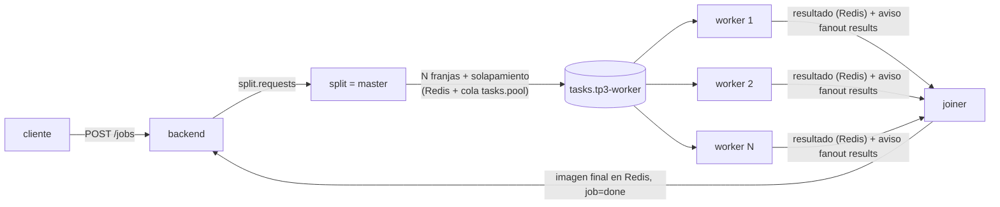

# Hit #1: operador de Sobel

**Responsable: Integrante A**

El operador de Sobel aplica las máscaras 3×3 `Gx = [[-1,0,1],[-2,0,2],[-1,0,1]]` y `Gy = Gxᵀ` a cada píxel en escala de grises. El resultado es `|G| = sqrt(Gx² + Gy²)`, recortado a [0, 255]. La implementación está en [ops.py](../services/common/tp3common/ops.py) (convolución vectorizada con NumPy y borde replicado) y es la misma en las tres etapas.

## Etapa 1: centralizado (una máquina, un proceso)
[etapa1/sobel_local.py](etapa1/sobel_local.py) lee la imagen, aplica Sobel y escribe el resultado, midiendo cada paso.
```bash
docker compose run --rm --no-deps -v "$PWD/TP3:/tp3" worker \
  python /tp3/hit1/etapa1/sobel_local.py /tp3/loadtest/sample.png /tmp/out.png
```

**Línea base** (imágenes de ruido incompresible de [gen_images.py](../loadtest/gen_images.py); contenedor `python:3.12-slim` en Docker Desktop, 8 vCPU; mediana de 3 corridas):

| Imagen | Píxeles | Leer (decode PNG) | Sobel | Escribir (encode PNG) | Total |
|---|---|---|---|---|---|
| 1 MB | 577×577 | 0.047 s | 0.012 s | 0.041 s | 0.10 s |
| 10 MB | 1825×1825 | 0.095 s | 0.164 s | 0.386 s | 0.65 s |
| 100 MB | 5773×5773 | 0.994 s | 3.138 s | 4.259 s | 8.4 s |

Ya en un solo proceso, el **cálculo** de Sobel es menos de la mitad del tiempo: decodificar y codificar PNG pesa igual o más. Esto es clave para entender la etapa 2.

## Etapa 2: distribuido (master-worker / worker farm en Docker)


1. `split` (master) parte la imagen en `FRAGMENTS_PER_IMAGE` franjas horizontales ([imaging.py](../services/common/tp3common/imaging.py)) y guarda cada una en Redis. Publica una tarea por franja.
2. Los `worker` compiten por la cola `tasks.tp3-worker` con `prefetch=1` (patrón de [ex1](../queue/ex1/)). Cada uno aplica la cadena de operaciones a su franja.
3. Cada worker avisa por el fanout `results` ([ex2](../queue/ex2/)). El `joiner` recorta el solapamiento de cada franja y las concatena en orden.

**Por qué hace falta solapamiento:** Sobel usa los 8 vecinos de cada píxel. Si se corta la imagen en franjas exactas, la primera y la última fila de cada franja no tienen a su vecino real: el borde se rellena replicando la fila, el gradiente vertical da ≈0 y al unir aparece **una línea negra en cada corte**. Por eso cada franja se extiende `required_overlap(ops)` filas hacia arriba y hacia abajo: 1 por cada operación 3×3 de la cadena, porque `blur,sobel` necesita 2. Después, el joiner descarta esas filas (`crop_core`). El test `test_ops_imaging.py` verifica que *partir + procesar + unir* da **exactamente** lo mismo que procesar la imagen entera.

**Tiempos por etapa del pipeline** (imagen de 10 MB, `ops=sobel`, 4 franjas, 3 corridas por fila, valores de `GET /jobs/{id}` → `timings_s`):

| Workers | split | queue | processing | join | total (mediana) |
|---|---|---|---|---|---|
| 1 | 0.59–1.22 s | 0.01–0.03 s | 0.69–0.77 s | 0.48–0.63 s | 1.93 s |
| 2 | 0.70–1.13 s | 0.01 s | 0.48–0.56 s | 0.51–0.74 s | 2.17 s |
| 4 | 0.53–0.95 s | 0.00–0.01 s | 0.31–0.66 s | 0.42–0.84 s | 1.58 s |

Se reproduce con `bash TP3/hit1/bench_distribuido.sh bench`.

**Lectura de los resultados:**
- La etapa de **processing** escala: pasa de ~0.73 s con 1 worker a ~0.45 s con 4. No es lineal, porque cada fragmento igual tiene que decodificarse y codificarse en PNG, y con 4 franjas ya no hay más paralelismo posible.
- El **total distribuido (≈1.6–2.2 s) es peor que el centralizado (0.65 s)** para 10 MB. El split y el join, que decodifican, codifican y mueven la imagen completa por Redis, más la red y las colas, cuestan más que el Sobel en sí (0.16 s). Sobel es una operación *memory-bound* y barata por píxel, así que la granularidad de 10 MB es demasiado fina para amortizar la comunicación (Foster, *Designing and Building Parallel Programs*: relación cómputo/comunicación).
- La distribución conviene cuando el **cómputo por fragmento domina**: imágenes de 100 MB (Sobel solo ya tarda 3 s), cadenas largas de operaciones, o muchos jobs concurrentes, donde la ganancia es en **throughput** porque N workers atienden N jobs a la vez. Además permite escalar horizontalmente fuera de una sola máquina (Hit #2/#3) y tolerar fallas (etapa 3). Ese análisis bajo carga se completa en el Hit #3 y en la matriz de R5.

## Etapa 3: tolerante a fallas

Mecanismos implementados:
1. **Ack manual + `prefetch=1`:** el worker hace `basic_ack` recién después de guardar el resultado y publicar el aviso. Si muere antes (crash, `SIGKILL`, OOM), RabbitMQ detecta que se cerró la conexión AMQP y **reentrega el fragmento sin ack a otro worker** (`redelivered=True`). Con `prefetch=1` cada worker tiene a lo sumo un fragmento en vuelo: se pierde y se rehace uno solo.
2. **Worker colgado (no muerto):** pika negocia un *heartbeat* AMQP de 60 s ([rabbit.py](../services/common/tp3common/rabbit.py)). Si el proceso deja de responder, el broker cierra la conexión tras perder los heartbeats y reentrega. Además, RabbitMQ aplica `consumer_timeout` (30 min por defecto) a todo mensaje que quede sin ack.
3. **Quorum queues con `x-delivery-limit=2`:** si un fragmento hace caer workers una y otra vez (*poison message*), no cicla para siempre: va a la DLQ ([ex3](../queue/ex3/)).
4. **`dlq-monitor`:** reasigna desde la DLQ con `attempt+1` hasta `MAX_RETRIES`. Después estaciona el fragmento en `tasks.parked`, el job queda en estado `dlq` y el admin puede reprocesarlo con `POST /admin/dlq/reprocess`.
5. **Heartbeat de aplicación:** cada worker refresca `worker:alive:<id>` en Redis cada 5 s con TTL. `/stats` cuenta los workers vivos, y la alerta `WorkersSinProcesar` avisa si hay cola y ningún worker procesa.
6. **Idempotencia:** el joiner marca los fragmentos terminados en un *set* de Redis, así que una reentrega que llegue duplicada no rompe el resultado.

**Demo** con `bash TP3/hit1/bench_distribuido.sh fallas`:
1. Levanta 2 workers y envía un job de 4 franjas con `blur,blur,blur,blur,sobel`.
2. Apenas un worker aparece en el job, lo mata con `SIGKILL`: es un crash real, no un apagado prolijo.

Salida observada:
```
job 94c6561c65934762ba97db9e84e187e8 enviado
worker /hit1-worker-1 (6d0400653df7) muerto con SIGKILL
{"status":"done","fragments":{"total":4,"done":4},"workers":["6d0400653df7-53ee2a","8768658acede-31e303"],...}
--- logs de los workers para este job
worker-2 | 00:27:24,394 INFO [worker] job=94c6... frag=0-1 ok en 1.576s (intento 0)
worker-2 | 00:27:25,213 INFO [worker] job=94c6... frag=0-0 ok en 0.788s (intento 0, reentregado)
worker-2 | 00:27:25,821 INFO [worker] job=94c6... frag=0-2 ok en 0.603s (intento 0)
worker-2 | 00:27:26,303 INFO [worker] job=94c6... frag=0-3 ok en 0.467s (intento 0)
```
- worker-1 había tomado el fragmento `0-0` (por eso figura en `workers`), pero murió antes del ack y nunca lo terminó.
- RabbitMQ se lo **reentregó** a worker-2 (`reentregado`) y el job terminó `done` con los 4 fragmentos.
- El cliente no notó nada, salvo ~0.8 s más de latencia.

**Detección: ack/conexión frente a heartbeat.** La detección por conexión AMQP es inmediata ante un crash, porque el socket se cierra. Ante un cuelgue tarda lo que el heartbeat (~60–120 s). El heartbeat en Redis no reasigna nada por sí mismo: sirve para **observar** (cuántos workers vivos, alertas). La reasignación siempre la hace RabbitMQ, porque es quien tiene el mensaje sin ack. Así se evitan carreras entre un "detector" externo y un worker lento que en realidad seguía vivo.
