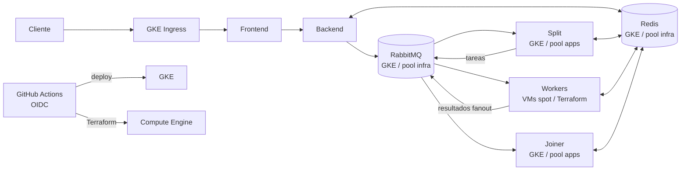

# Hit #2: Sobel con offloading en la nube

**Responsable: Integrante C**

Workers bajo demanda con Terraform: [TP3/infra/terraform/workers](../infra/terraform/workers/).

| Paso | Cómo |
|---|---|
| Provisioning | `google_compute_instance` con `count = var.worker_count`, repartidas en varias zonas por las cuotas |
| Bootstrap | `startup-script` (equivalente a `user_data`) instala Docker: [startup.sh.tftpl](../infra/terraform/workers/startup.sh.tftpl) |
| Deploy | `docker pull` del Artifact Registry privado con el SA de la VM (sin claves) |
| Join | `docker run` del worker. Se conecta a RabbitMQ y Redis con retry y backoff |
| Teardown | `worker_count=0` o `terraform destroy` (pipeline `workers.yml`) |

Requisitos IaC: remote state en GCS (con lock nativo), archivos `provider/variables/main/outputs.tf`, plan en cada PR y apply manual o al mergear.

## Arquitectura híbrida (tipo 1)

El plano de control y los servicios de plataforma corren en GKE. Las VMs de workers
se crean aparte con Terraform y consumen trabajo de RabbitMQ y estado de Redis a
través de sus servicios `LoadBalancer` internos. Así, el cómputo se escala sin
exponer las colas ni Redis a Internet.



| Servicio | ¿Local o nube? | Por qué |
|---|---|---|
| frontend / backend | GKE, con overlay local para desarrollo | Entrada y API de la aplicación; los deployments usan el pool `apps`. |
| RabbitMQ / Redis | GKE, pool `infra` | Estado y mensajería compartidos; los workers externos acceden por IPs internas del VPC. |
| split / joiner | GKE, pool `apps` | Orquestan el procesamiento cerca de la API y de las colas. |
| workers | VMs en Compute Engine, fuera del cluster | Cómputo elástico: se ajusta `worker_count` sin escalar el pool de aplicaciones. |

> En un cluster RabbitMQ, las quorum queues priorizan consistencia y disponibilidad de mayoría (CP); Redis con replicación asíncrona puede servir lecturas temporalmente atrasadas (AP). Los manifiestos actuales despliegan una sola réplica de cada servicio, por lo que no proporcionan alta disponibilidad. Los workers solo alcanzan RabbitMQ/Redis por el VPC y sus credenciales salen de Secret Manager.

## Cómo correr
```bash
cd TP3/infra/terraform/workers
terraform init -backend-config="bucket=<project>-tp3-tfstate"
terraform apply -var project_id=... -var workers_service_account=... \
  -var worker_image=us-central1-docker.pkg.dev/<p>/tp3/worker:latest \
  -var rabbit_host=<ip> -var redis_host=<ip> -var worker_count=2
terraform apply ... -var worker_count=0   # teardown
```

## Kubernetes local

Con Docker Desktop, Minikube, `kubectl` y Docker Compose instalados, crear
`.env` desde `.env.example` y establecer credenciales locales; luego ejecutar
`bash TP3/scripts/local_up.sh` desde Git Bash o WSL. El script construye las imágenes,
las carga en Minikube, crea los Secrets del namespace `tp3` a partir del `.env` y
aplica el overlay local. No usa GCP.

## Evidencia R1

Para probar el acceso al registry privado desde Minikube, autenticar `gcloud` con
permisos de lectura en Artifact Registry y ejecutar:

```bash
R1_IMAGE=us-central1-docker.pkg.dev/<project>/tp3/backend:<tag> \
  bash TP3/scripts/r1_evidence.sh
```

El script documenta primero `ImagePullBackOff` sin credenciales y luego el mismo
Deployment funcionando con un `imagePullSecret` temporal. La salida se guarda en
`TP3/evidencia/r1/`; no subir tokens ni credenciales al repositorio.
