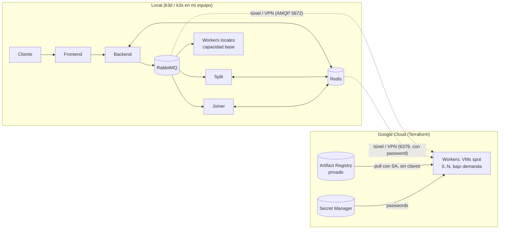

# Hit #2: Sobel con offloading en la nube

**Responsable: Integrante C**

Workers bajo demanda con Terraform: [TP3/infra/terraform/workers](../infra/terraform/workers/).

| Paso | Cómo |
|---|---|
| Provisioning | `google_compute_instance` con `count = var.worker_count`, repartidas en varias zonas por las cuotas |
| Bootstrap | `startup-script` (equivalente a `user_data`) instala Docker: [startup.sh.tftpl](../infra/terraform/workers/startup.sh.tftpl) |
| Deploy | `docker pull` del Artifact Registry privado con el SA de la VM (sin claves) |
| Join | `docker run` del worker. Se conecta a RabbitMQ y Redis con retry y backoff |
| Teardown | `worker_count=0` o `terraform destroy` (pipeline `workers.yml`) |

Requisitos IaC: remote state en GCS (con lock nativo), archivos `provider/variables/main/outputs.tf`, plan en cada PR y apply manual o al mergear.

## Arquitectura híbrida (tipo 1): local + cloud-bursting

La consigna pide un esquema **híbrido**: parte de la aplicación corre en equipos locales
(on-premise) y el cómputo intensivo se "desborda" a la nube (cloud-bursting). Los workers
de Sobel son las únicas piezas que se crean y destruyen on-demand en GCP con Terraform.



| Servicio | ¿Local o nube? | Por qué |
|---|---|---|
| frontend / backend | Local | Es la entrada de la aplicación; no es cómputo intensivo y no justifica pagar nube. |
| split / joiner | Local | Operan sobre metadatos y fragmentos pequeños, cerca de RabbitMQ y Redis (baja latencia). |
| RabbitMQ / Redis | Local | Son el punto de coordinación; si estuvieran en la nube, cada mensaje local cruzaría Internet. |
| workers base | Local | Capacidad propia (costo fijo ya pagado). |
| workers extra | **Nube (VMs spot)** | Cómputo elástico: se crean al saturarse la capacidad local y se destruyen al terminar (`worker_count=0`). Se paga solo por el tiempo de uso. |
| imágenes y secretos | Nube (Artifact Registry, Secret Manager) | Registry privado (R1) y credenciales sin claves estáticas en las VMs. |

**Cómo llegan las VMs a la RabbitMQ/Redis locales.** Es el punto delicado del esquema híbrido:
las VMs necesitan una ruta de red hacia tu equipo. Opciones, de más a menos recomendable:
VPN/overlay (Tailscale, WireGuard), túnel TCP (cloudflared, ngrok) o IP pública con port-forward
restringido por firewall. En todos los casos se pasa esa dirección como `rabbit_host` / `redis_host`.
No exponer Redis sin password (el Deployment de Redis del overlay local no la tiene: agregar
`--requirepass` antes de abrirlo) ni dejar AMQP abierto a todo Internet.

> **Pendiente de validar:** la conectividad VM → RabbitMQ local depende de tu red. Probarla con
> `worker_count=1` y comprobar en la UI de RabbitMQ que aparece el consumer de la VM.

## Qué cambia en el Hit #3 (100% nube)

En el Hit #3 todo corre en GKE (RabbitMQ y Redis en el nodepool `infra`; frontend, backend,
split, joiner y dlq-monitor en `apps`) y solo los workers quedan en VMs fuera del cluster. Las VMs
alcanzan RabbitMQ/Redis por los `LoadBalancer` internos del VPC, sin exponerlos a Internet.
Ver [hit3/README.md](../hit3/README.md) y [infra/README.md](../infra/README.md).

| Servicio | Hit #2 (híbrido) | Hit #3 (cloud native) |
|---|---|---|
| frontend, backend, split, joiner | Local | GKE, pool `apps` |
| RabbitMQ, Redis | Local | GKE, pool `infra` |
| workers | Local + VMs en la nube | VMs en la nube (fuera del cluster) |

> En un cluster RabbitMQ, las quorum queues priorizan consistencia (CP): ante una partición, la
> minoría deja de aceptar escrituras. Redis con replicación asíncrona prioriza disponibilidad (AP):
> puede servir lecturas atrasadas o perder escrituras recientes al hacer failover. Los manifiestos
> actuales despliegan una sola réplica de cada uno, por lo que no ofrecen alta disponibilidad.

## Cómo correr
```bash
cd TP3/infra/terraform/workers
terraform init -backend-config="bucket=<project>-tp3-tfstate"
terraform apply -var project_id=... -var workers_service_account=... \
  -var worker_image=us-central1-docker.pkg.dev/<p>/tp3/worker:latest \
  -var rabbit_host=<ip> -var redis_host=<ip> -var worker_count=2
terraform apply ... -var worker_count=0   # teardown
```

## Kubernetes local

El cluster local es **k3d** (Windows/macOS) o **k3s** (Linux/WSL2), según la Práctica 0 de la cátedra
(Minikube también funciona). Con Docker, `kubectl` y el cluster elegido instalados, crear `.env`
desde `.env.example` con credenciales locales y ejecutar desde Git Bash o WSL:

```bash
bash TP3/scripts/local_up.sh            # detecta k3d / k3s / minikube
CLUSTER=minikube bash TP3/scripts/local_up.sh   # forzar uno
```

El script crea el cluster, construye las imágenes, las importa (`k3d image import`,
`k3s ctr images import` o `minikube image load`), crea los Secrets del namespace `tp3` a partir del
`.env` y aplica `TP3/k8s/overlays/local`. No usa GCP.

## Evidencia R1

Para probar el acceso al registry privado desde el cluster local, autenticar `gcloud` con
permisos de lectura en Artifact Registry y ejecutar:

```bash
R1_IMAGE=us-central1-docker.pkg.dev/<project>/tp3/backend:<tag> \
  bash TP3/scripts/r1_evidence.sh
```

El script documenta primero `ImagePullBackOff` sin credenciales y luego el mismo
Deployment funcionando con un `imagePullSecret` temporal. La salida se guarda en
`TP3/evidencia/r1/`; no subir tokens ni credenciales al repositorio.
