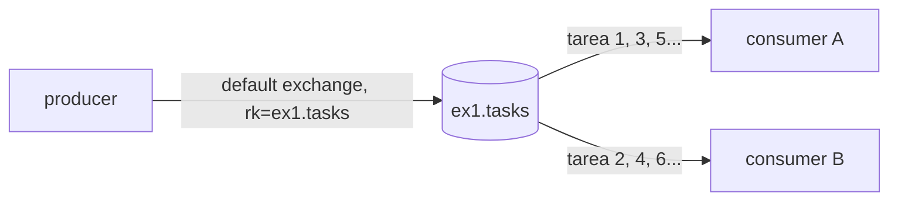

# Ejemplo 1: Message Queue (punto a punto)

**Consigna:** un productor envía 10 tareas numeradas a una cola y un consumidor las imprime. Después se levantan 2 consumidores y se observa cómo se reparten (round-robin).



## Implementación
- [`producer.py`](producer.py): declara la cola durable `ex1.tasks` y publica `tarea 1` … `tarea 10` como mensajes persistentes (`delivery_mode=2`) por el *default exchange*.
- [`consumer.py`](consumer.py): ack manual. Variables de entorno:
  - `PREFETCH`: 0 deja el default de RabbitMQ, sin límite; 1 es el valor por defecto acá.
  - `WORK_SECONDS`: simula el costo de procesar.
  - `CONSUMER_ID`: nombre que aparece en el log.
- [`k8s.yaml`](k8s.yaml): Deployment de consumidores (`replicas: 2`) y Job productor.

## Cómo correr
```bash
bash TP3/queue/run_demo.sh ex1              # solo Docker: reproduce las 3 salidas de abajo
# Kubernetes (minikube con el overlay local aplicado y la imagen cargada):
docker build -t tp3/queue-examples:dev TP3/queue && minikube image load tp3/queue-examples:dev
kubectl apply -f TP3/queue/ex1/k8s.yaml
kubectl -n tp3 logs -l app=ex1-consumer -f --prefix
```

## Resultados observados

**1 consumidor:** recibe las 10 tareas en orden.
```
[consumer A] tarea 1
[consumer A] tarea 2
...
[consumer A] tarea 10
```

**2 consumidores con el prefetch por defecto (sin límite), A lento (1 s) y B rápido (0.1 s):** round-robin estricto. Cada uno recibe 5 tareas alternadas, sin importar que A tarde 10 veces más.
```
[consumer A] tarea 2, 4, 6, 8, 10
[consumer B] tarea 1, 3, 5, 7, 9
```

**2 consumidores con `prefetch_count=1`, mismos tiempos:** *fair dispatch*. RabbitMQ no le entrega otra tarea a un consumidor hasta que hace ack de la anterior. A procesó 1 tarea y B las otras 9.
```
[consumer A] tarea 2
[consumer B] tarea 1, 3, 4, 5, 6, 7, 8, 9, 10
```

## Conclusión
- RabbitMQ despacha en **round-robin entre los consumidores conectados**. Cada mensaje llega a **un solo** consumidor: es la semántica de cola de trabajo.
- El round-robin es **al despachar, no al terminar**. Sin `prefetch` RabbitMQ empuja los mensajes apenas llegan, y el consumidor lento acumula un backlog local mientras el rápido queda ocioso.
- Con `prefetch=1` el reparto se adapta a la velocidad de cada consumidor. Por eso los workers del TP usan `prefetch=1` ([worker/main.py](../../services/worker/main.py)). Además, si un worker muere, solo pierde el único mensaje sin ack, que RabbitMQ reentrega a otro.
