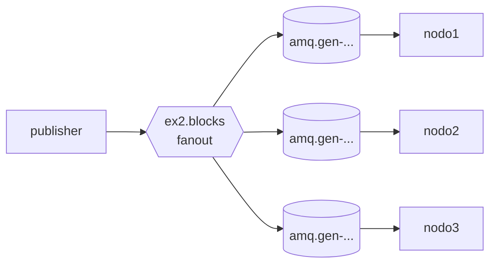

# Ejemplo 2: Pub/Sub (fan-out)

**Consigna:** un publicador emite eventos "nuevo bloque minado" por un exchange `fanout` y 3 suscriptores (nodos) reciben cada mensaje. Hay que verificar que los tres reciben exactamente lo mismo. Relacionarlo con AWS EventBridge, Google Pub/Sub y Kafka.



## Implementación
- [`publisher.py`](publisher.py): declara el exchange `ex2.blocks` (fanout) y publica `N_BLOCKS` eventos `{"block", "hash", "prev", "ts"}`. Cada hash encadena el anterior.
- [`subscriber.py`](subscriber.py): cada nodo declara una cola **anónima y exclusiva** (`queue_declare('', exclusive=True)`) y la bindea al exchange. Con `EXPECTED=N` termina después de N bloques e imprime un *digest* (SHA-256) de la secuencia que recibió.
- [`k8s.yaml`](k8s.yaml): Deployment de 3 suscriptores y Job publicador. El publicador espera `START_DELAY=15` s para que los nodos ya estén bindeados.

## Cómo correr
```bash
bash TP3/queue/run_demo.sh ex2
kubectl apply -f TP3/queue/ex2/k8s.yaml && kubectl -n tp3 logs -l app=ex2-subscriber -f --prefix
```

## Resultados observados
```
[publisher] bloque 1 minado: 7ca227d548dc
...
[publisher] bloque 5 minado: bb56a8972f7f
[nodo nodo1] suscripto a ex2.blocks con la cola amq.gen-tFHealUPdN1Dw8t_d61P4w
[nodo nodo1] bloque 1 7ca227d548dc ... bloque 5 bb56a8972f7f
[nodo nodo1] recibidos 5 bloques, digest 578c788036578a18
[nodo nodo2] recibidos 5 bloques, digest 578c788036578a18
[nodo nodo3] recibidos 5 bloques, digest 578c788036578a18
[nodo tardio] suscripto a ex2.blocks con la cola amq.gen-zrolpc9oJ1obfSbQ8U-kwQ
[nodo tardio] bloque 4 bc0b9b5f46ea
[nodo tardio] bloque 5 bb56a8972f7f
```
- Los 3 nodos imprimen **el mismo digest**: recibieron los mismos 5 bloques en el mismo orden. Cada uno tiene su propia cola, y el exchange copia el mensaje a todas.
- El **nodo tardío** se conectó entre el bloque 3 y el 4, y **no recibe los bloques anteriores**. Un exchange fanout no almacena nada: si en el momento de publicar no hay cola bindeada, el mensaje se descarta para ese suscriptor.

## Relación con servicios gestionados
| | RabbitMQ fanout | AWS EventBridge / SNS | Google Pub/Sub | Kafka |
|---|---|---|---|---|
| Unidad de suscripción | una cola por suscriptor | regla → target (SNS: suscripción) | *subscription* por consumidor | *consumer group* |
| Retención | ninguna en el exchange; la cola guarda desde que se bindea | ninguna (EventBridge tiene *archive/replay* opcional) | 7 días por defecto en la suscripción | log persistente con retención configurable |
| Suscriptor tardío | se pierde lo anterior | se pierde (salvo *replay*) | recibe desde que se crea la suscripción (o *seek*) | puede leer desde el offset 0 |
| Filtrado | no (eso es `topic`/`headers`) | por patrones del evento | por atributos | por partición o del lado del consumidor |

En Kafka, el "nuevo bloque" sería un mensaje en un *topic* con un consumer group por nodo. Un nodo que llega tarde puede releer desde el principio, que es lo que necesita una blockchain real para sincronizarse.

## En la app del TP
El exchange `results` (fanout) avisa de cada fragmento terminado al **joiner** (`results.joiner`) y al **monitor** (`results.monitor`). Los dos ven todos los resultados sin acoplarse entre sí ([rabbit.py](../../services/common/tp3common/rabbit.py)).
