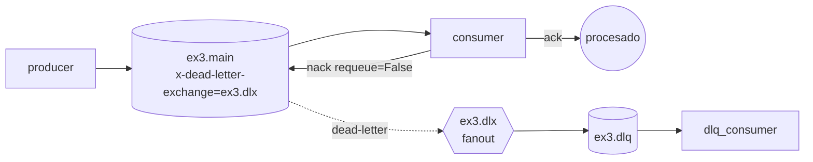

# Ejemplo 3: Dead Letter Queue

**Consigna:** una cola principal con Dead Letter Exchange. El consumidor hace `nack` a los mensajes con `"error": true`, que pasan a la DLQ. Un segundo consumidor lee la DLQ e imprime los mensajes fallidos.



## Implementación
- [`topology.py`](topology.py): declara `ex3.dlx` (fanout), `ex3.dlq` bindeada a él y `ex3.main` con `x-dead-letter-exchange: ex3.dlx`. Es idempotente y la llaman los tres scripts, así que no importa el orden en que arranquen.
- [`producer.py`](producer.py): 10 mensajes. Uno de cada 3 lleva `"error": true` (`ERROR_EVERY`).
- [`consumer.py`](consumer.py): `basic_ack` a los válidos y `basic_nack(requeue=False)` a los erróneos.
- [`dlq_consumer.py`](dlq_consumer.py): imprime cada mensaje muerto con el motivo y la cola de origen, sacados del header `x-death` que agrega RabbitMQ.
- [`k8s.yaml`](k8s.yaml): Deployments del consumidor y del lector de la DLQ, y Job productor.

## Cómo correr
```bash
bash TP3/queue/run_demo.sh ex3
kubectl apply -f TP3/queue/ex3/k8s.yaml && kubectl -n tp3 logs deploy/ex3-dlq-consumer -f
```

## Resultados observados
```
[consumer] mensaje 1 procesado OK
[consumer] mensaje 2 procesado OK
[consumer] mensaje 3 con error -> nack, va a la DLQ
...
[consumer] mensaje 9 con error -> nack, va a la DLQ
[consumer] mensaje 10 procesado OK
--- DLQ
[dlq] {'id': 3, 'payload': 'pedido 3', 'error': True} | motivo=rejected, cola origen=ex3.main
[dlq] {'id': 6, 'payload': 'pedido 6', 'error': True} | motivo=rejected, cola origen=ex3.main
[dlq] {'id': 9, 'payload': 'pedido 9', 'error': True} | motivo=rejected, cola origen=ex3.main
```
Los 3 mensajes con error (3, 6 y 9) terminan en la DLQ con `reason=rejected`, y los otros 7 se procesan normalmente. Además de `rejected`, RabbitMQ también dead-letterea por `expired` (venció el TTL), `maxlen` (cola llena) y `delivery_limit` (quorum queues).

## Por qué importa
Sin DLQ, un mensaje que siempre falla (*poison message*) tiene dos destinos posibles, los dos malos: con `requeue=True` cicla para siempre consumiendo CPU, y con `ack` se pierde en silencio. La DLQ lo aparta, preserva el contenido y el motivo, y permite inspeccionarlo o reprocesarlo.

En el TP, las colas `tasks.<pool>` tienen `x-dead-letter-exchange: tasks.dlx`. El `dlq-monitor` consume `tasks.dlq` y reasigna los fragmentos ([dlq_monitor/main.py](../../services/dlq_monitor/main.py)).
