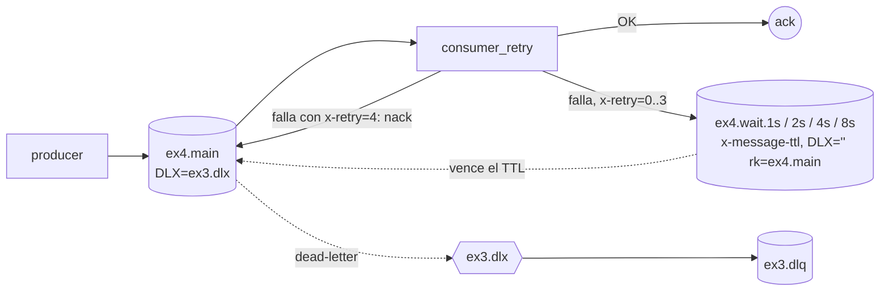

# Ejemplo 4: Retry con exponential backoff

**Consigna:** si el procesamiento falla (simulado con 50% de probabilidad), el mensaje se reencola con esperas de 1, 2, 4 y 8 segundos. Tras 4 reintentos fallidos va a la DLQ del ejemplo 3. Cada intento y su espera quedan registrados en el log.

## Diseño: una cola de espera por nivel (sin plugin)



1. El número de reintento viaja en el header `x-retry`. El primer intento no lo tiene.
2. Si falla y `x-retry < 4`, el consumidor publica una copia en `ex4.wait.<2^x-retry>s` con `x-retry+1` y hace **ack** del original.
3. Las colas de espera no tienen consumidores y tienen `x-message-ttl` fijo. Cuando vence el TTL, su DLX (el *default exchange*, `""`, con `x-dead-letter-routing-key=ex4.main`) devuelve el mensaje a la cola principal.
4. Si falla el 5º intento (los 4 reintentos agotados), el consumidor hace `nack(requeue=False)` y `ex4.main`, con DLX `ex3.dlx`, lo manda a **la DLQ del ejemplo 3**.

**Por qué una cola por nivel y no TTL por mensaje en una sola cola:** RabbitMQ solo expira el mensaje que está en la **cabeza** de la cola. Con una única cola de espera, un mensaje de 8 s delante de uno de 1 s retiene al segundo 8 s. Con colas separadas, todos los mensajes de una cola tienen el mismo TTL, así que el orden de llegada coincide con el de vencimiento. La alternativa es el plugin `rabbitmq_delayed_message_exchange`, que no hace falta instalar con este diseño.

## Implementación
- [`topology.py`](topology.py): `ex4.main`, las 4 colas de espera y el `ex3.dlx`/`ex3.dlq` del ejemplo 3, con los mismos argumentos.
- [`producer.py`](producer.py): `N_MSGS` trabajos.
- [`consumer_retry.py`](consumer_retry.py): falla con probabilidad `FAIL_PROB` (0.5). `SEED` hace la demo reproducible.
- [`k8s.yaml`](k8s.yaml): consumidor y Job productor. Aplicar junto con el `ex3-dlq-consumer` para ver la DLQ.

## Cómo correr
```bash
bash TP3/queue/run_demo.sh ex4
kubectl apply -f TP3/queue/ex3/k8s.yaml -f TP3/queue/ex4/k8s.yaml && kubectl -n tp3 logs deploy/ex4-consumer -f
```

## Resultados observados (`SEED=7`, 5 trabajos)
```
00:09:19 [worker] trabajo 1: intento 1 FALLO, reintento en 1s
00:09:19 [worker] trabajo 2: intento 1 FALLO, reintento en 1s
00:09:19 [worker] trabajo 3: intento 1 OK
00:09:19 [worker] trabajo 4: intento 1 FALLO, reintento en 1s
00:09:19 [worker] trabajo 5: intento 1 OK
00:09:20 [worker] trabajo 1: intento 2 FALLO, reintento en 2s
00:09:20 [worker] trabajo 2: intento 2 FALLO, reintento en 2s
00:09:20 [worker] trabajo 4: intento 2 OK
00:09:22 [worker] trabajo 1: intento 3 FALLO, reintento en 4s
00:09:22 [worker] trabajo 2: intento 3 FALLO, reintento en 4s
00:09:26 [worker] trabajo 1: intento 4 FALLO, reintento en 8s
00:09:26 [worker] trabajo 2: intento 4 FALLO, reintento en 8s
00:09:34 [worker] trabajo 1: intento 5 FALLO, 4 reintentos agotados -> DLQ
00:09:34 [worker] trabajo 2: intento 5 OK
--- DLQ (consumidor del ej. 3)
[dlq] {'id': 1} | motivo=rejected, cola origen=ex4.main, reintentos=4
```
Los timestamps muestran las esperas reales entre intentos: 19→20 (1 s), 20→22 (2 s), 22→26 (4 s) y 26→34 (8 s). El trabajo 2 se recuperó en el último intento. El trabajo 1 falló los 5 y terminó en `ex3.dlq` con `x-retry=4`.

## Backoff en la app del TP
- **Conexiones** a RabbitMQ y Redis: 1, 2, 4, 8… s con tope de 30 s ([retry.py](../../services/common/tp3common/retry.py)).
- **Fragmentos que fallan:** `dlq-monitor` los reencola con `attempt+1` hasta `MAX_RETRIES`. Después los estaciona en `tasks.parked` y el admin decide qué hacer.
