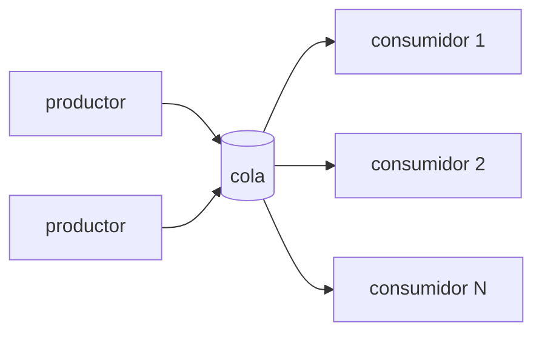
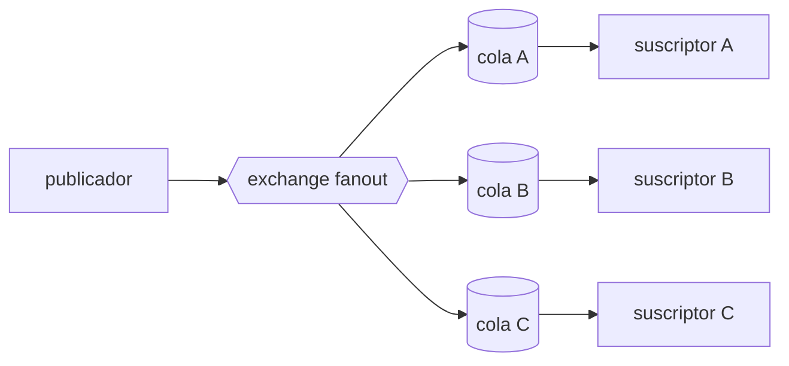
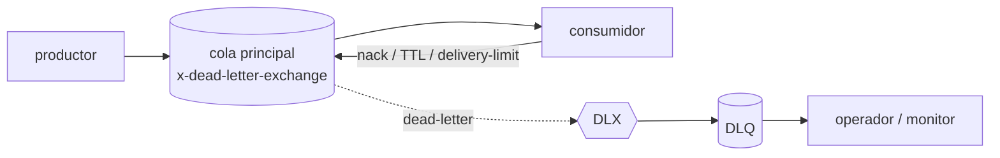
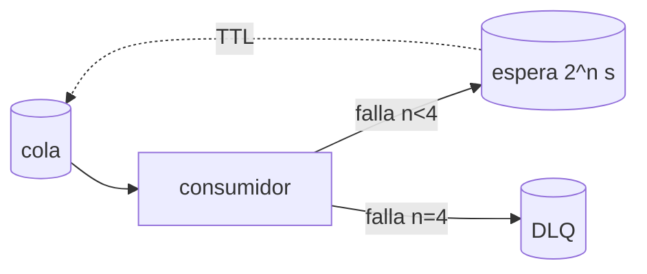
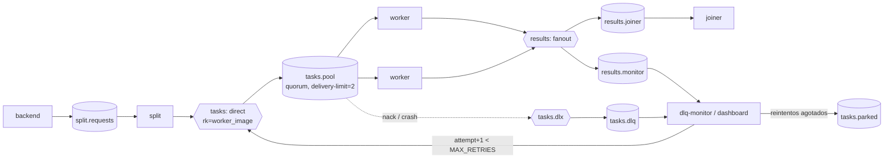

# Ejemplo 5: discusión comparativa

**Responsable: A**

Los cuatro patrones (Hohpe & Woolf, *Enterprise Integration Patterns*) resuelven problemas distintos y en la práctica se combinan. La app del TP usa los cuatro.

## 1. Message Queue (Point-to-Point Channel / Competing Consumers)

- **Qué hace:** cada mensaje lo procesa **exactamente un** consumidor de los que compiten. Agregar consumidores aumenta el throughput (escalado horizontal).
- **Garantías:** al menos una vez con ack manual (si el consumidor muere antes del ack, se reentrega, así que el procesamiento debe ser idempotente). Orden FIFO en la cola, pero **no** global con varios consumidores. Mensajes persistentes y cola durable sobreviven a un reinicio del broker.
- **Cuándo usarlo:** repartir trabajo entre workers (*worker farm*), absorber picos (la cola hace de buffer) y desacoplar en el tiempo al productor del consumidor.
- **Cuándo no:** cuando varios sistemas necesitan enterarse del mismo evento (usar Pub/Sub), o cuando hace falta orden estricto con paralelismo (particionar por clave, como Kafka).
- **Ejemplos:** AWS SQS, Google Cloud Tasks, Azure Queue Storage, Celery/Sidekiq.

## 2. Publish/Subscribe (fanout)

- **Qué hace:** **cada** suscriptor recibe una copia de cada evento. El publicador no sabe cuántos suscriptores hay.
- **Garantías:** igual que la cola, pero por suscriptor. En RabbitMQ no hay retención en el exchange: el suscriptor que no está bindeado al publicar no recibe ese mensaje (lo vimos en ex2).
- **Cuándo usarlo:** notificar eventos de dominio a varios sistemas independientes (auditoría, métricas, caché, búsqueda) y agregar consumidores nuevos sin tocar al productor.
- **Cuándo no:** si el trabajo se debe hacer una sola vez (con N suscriptores se haría N veces). Si un suscriptor nuevo necesita el histórico, conviene un log (Kafka, Pub/Sub con *seek*, EventBridge *archive*).
- **Ejemplos:** AWS SNS y EventBridge, Google Pub/Sub, Kafka topics con un consumer group por servicio, Redis Pub/Sub (sin persistencia).

## 3. Dead Letter Queue (Dead Letter Channel)

- **Qué hace:** aparta los mensajes que no se pueden procesar (rechazados, vencidos, que superaron el límite de entregas) a otra cola, con el motivo en `x-death`.
- **Garantías:** el mensaje no se pierde ni bloquea la cola principal. Por sí sola **no reintenta**; eso lo hace otro componente.
- **Cuándo usarlo:** siempre que un consumidor pueda fallar con mensajes concretos (*poison messages*: datos corruptos, bugs con ciertos inputs). Es la base para alertar y reprocesar a mano.
- **Cuándo no:** no sirve para fallas transitorias como "el servicio externo está caído". Ahí conviene primero reintentar con backoff, y la DLQ queda como último recurso.
- **Ejemplos:** SQS redrive policy, DLQ de Google Pub/Sub, `errors.deadletterqueue` de Kafka Connect.

## 4. Retry con exponential backoff

- **Qué hace:** reintenta las fallas transitorias espaciando los intentos (1, 2, 4, 8 s…), con un máximo de intentos y, en las conexiones, un tope de espera.
- **Garantías:** se recupera de fallas pasajeras sin intervención. El backoff evita la **tormenta de reintentos**: N clientes reintentando a la vez contra un servicio que recién se levanta lo vuelven a tirar. En producción conviene agregar *jitter* aleatorio para desincronizar a los clientes.
- **Cuándo usarlo:** errores de red, timeouts, `503`, broker o DB reiniciándose.
- **Cuándo no:** errores deterministas (input inválido, `400`), porque reintentar no cambia el resultado y solo agrega latencia: van directo a la DLQ. Tampoco sin límite: el retry infinito sin backoff está prohibido en la consigna y es un antipatrón.
- **Ejemplos:** retries de los SDKs de AWS y GCP, backoff de Pub/Sub, Resilience4j, `tenacity` en Python.

## Tabla comparativa
| Patrón | Destinatarios de cada mensaje | Garantía principal | Caso de uso típico | Riesgo si se usa mal |
|---|---|---|---|---|
| Message Queue | 1 de N consumidores | al menos una vez, balanceo de carga | worker farm, procesamiento en segundo plano | sin idempotencia, una reentrega duplica efectos; sin prefetch, mal balanceo |
| Pub/Sub | todos los suscriptores | difusión desacoplada | eventos de dominio, notificaciones | trabajo duplicado si se usa para tareas; suscriptores tardíos pierden eventos |
| DLQ | operador o monitor | ningún mensaje se pierde ni bloquea | poison messages, auditoría de fallas | DLQ que nadie mira (fallas silenciosas): requiere alertas |
| Retry/backoff | el mismo consumidor, más tarde | recuperación de fallas transitorias | red, broker o DB inestables | reintentar errores permanentes; retry sin tope ni backoff que satura al servicio caído |

## Cómo se combinan en nuestra app

- **Message Queue:** `tasks.<pool>` reparte fragmentos entre los workers con `prefetch=1`.
- **Pub/Sub:** `results` avisa de cada fragmento terminado al joiner y al monitor a la vez.
- **DLQ:** un fragmento que falla o hace caer al worker más de `x-delivery-limit` veces va a `tasks.dlq`.
- **Retry:** `dlq-monitor` lo reencola con `attempt+1`. Al agotar `MAX_RETRIES` lo estaciona y el job queda en estado `dlq`, reprocesable por el admin. Las conexiones usan backoff de 1/2/4/8 s con tope de 30 s.

Topología completa en [rabbit.py](../../services/common/tp3common/rabbit.py).
