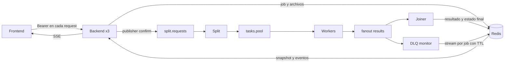

# Servicios

| Servicio | Responsable | Qué hace | Puerto (health y metrics) |
|---|---|---|---|
| [common/](common/) | todos (cambios por PR) | Contratos: colas, claves Redis, auth, operaciones, logging, métricas, retry | n/a |
| [backend/](backend/) | B | API HTTP, validación R2, auth y roles R4, `/stats` | 8000 (`/health`, `/metrics`) |
| [split/](split/) | B | Parte las imágenes en franjas y publica las tareas | 8080 |
| [joiner/](joiner/) | B | Une los fragmentos y marca el job como `done` | 8080 |
| [dlq_monitor/](dlq_monitor/) | B | Reasigna desde la DLQ, estaciona, guarda eventos de progreso y publica `tasks_queued` | 8080 |
| [worker/](worker/) | A | Aplica la cadena de operaciones a un fragmento | 8080 |
| [frontend/](frontend/) | B | Upload, progreso SSE, resultados, panel admin y proxy `/api` | 8080 (`/health`) |

## Desarrollo
```bash
cp .env.example .env              # completar AUTH_SECRET y RABBIT_PASS (y el mismo pass en RABBIT_URL)
docker compose up -d --build --scale worker=3
TOKEN=$(docker compose exec -T backend python /dev/stdin alice user < TP3/scripts/gen_token.py)
curl -H "Authorization: Bearer $TOKEN" -F files=@TP3/loadtest/sample.png -F ops=blur,sobel localhost:8000/jobs
curl -H "Authorization: Bearer $TOKEN" localhost:8000/jobs/<job_id>
# UI: http://localhost:8081   Swagger: http://localhost:8000/docs   RabbitMQ: http://localhost:15672
```

## Arquitectura y decisiones (B)



- **Stateless:** cada request verifica el token HMAC-SHA256. Identidad, roles y vencimiento viajan en el Bearer; estado y rate limit viven en Redis. Cambiar de réplica no requiere afinidad ni una sesión local.
- **Concurrencia:** upload usa lectura async; validación de imagen, Redis y pika se ejecutan en el threadpool. Las conexiones pika son por hilo, nunca compartidas entre hilos.
- **Publicación:** cinco intentos con esperas 1/2/4/8 s y confirmación del broker. En reproceso de DLQ, el ack ocurre después de actualizar el estado y confirmar la publicación; un error deja el mensaje sin ack para reentrega.
- **Redis:** lecturas y escrituras explícitamente idempotentes se reintentan. `INCR` no se reintenta automáticamente. Los auxiliares por job expiran; los índices conservan el tipo set y eliminan referencias vencidas en las consultas.
- **Progreso:** `results.monitor` guarda un Redis Stream acotado y deduplicado. SSE envía snapshot inicial y cambios, verifica vencimiento del token y se renueva cada 55 s. Nginx desactiva buffering. El estado del joiner se vuelve a consultar para evitar una carrera entre los dos consumidores del fanout.
- **Administración:** `/stats` y `/admin/*` requieren admin. Consultar jobs, eventos o resultados ajenos da 404. El frontend mantiene tokens solo en memoria.
- **Diagnóstico:** `/health` prueba Redis y RabbitMQ; `X-Backend-Replica` identifica el contenedor/pod para R4.

Contrato completo y limitaciones: [contrato.md](../docs/contrato.md). Diagrama global: [arquitectura.md](../docs/arquitectura.md).

### Cambios compartidos que debe conocer el equipo

B mantiene nombres y payloads existentes de colas y el formato de sets Redis. Agrega `job:{id}:events` y `job:{id}:events:seen`, TTL para auxiliares y helpers de recuperación en `tp3common`. Worker y joiner aplican el TTL de sus sets/metadatos. Es necesario reconstruir **todos** los servicios Python al integrar esta rama.

## Tests

Desde la raíz, Python 3.11 o posterior:

```bash
python -m venv .venv
source .venv/bin/activate
pip install -e TP3/services/common -r TP3/services/backend/requirements.txt -r TP3/services/requirements-test.txt
python -m pytest -q
```

Sin `TP3_INTEGRATION=1`, las pruebas que requieren servicios reales se omiten. Para correrlas, levantar Redis y RabbitMQ en un entorno local de pruebas y usar una **base Redis vacía y exclusiva** (por ejemplo `/15`):

```bash
export TP3_INTEGRATION=1
export REDIS_URL=redis://localhost:6379/15
export RABBIT_URL=amqp://tp3:<password-local>@localhost:5672/
python -m pytest -q
```

Las colas de integración tienen prefijos aleatorios. El fixture comprueba que Redis esté vacío y al terminar elimina las claves de la prueba; no usar una base con datos de trabajo. CI levanta ambos servicios aislados en GitHub Actions y ejecuta la suite completa.

Cobertura: submit → split → worker → join → resultado, igualdad con procesamiento centralizado, SSE, roles y aislamiento, errores antes de encolar, rate limit, TTL e índices, deduplicación de eventos, reproceso, health, reintentos y ejecución fuera del event loop.

## Evidencia R4 con tres réplicas

Local con Docker Compose (requiere soporte para `!reset`):

```bash
docker compose -p tp3-b -f docker-compose.yml -f docker-compose.r4.yml up -d --build --scale backend=3 --scale worker=3
# La API queda detrás del frontend: http://localhost:8081/api
export ADMIN_TOKEN=$(docker compose -p tp3-b exec -T backend python /dev/stdin r4-admin admin < TP3/scripts/gen_token.py)
export USER_A_TOKEN=$(docker compose -p tp3-b exec -T backend python /dev/stdin r4-alice user < TP3/scripts/gen_token.py)
export USER_B_TOKEN=$(docker compose -p tp3-b exec -T backend python /dev/stdin r4-bob user < TP3/scripts/gen_token.py)
set -o pipefail
BASE_URL=http://localhost:8081/api bash TP3/scripts/r4_evidence.sh | tee TP3/evidencia/r4_local.txt
```

El script exige tres valores distintos de `X-Backend-Replica`, valida 30 consultas, aislamiento también en SSE/resultados y espera que el pipeline termine. Un balanceador con afinidad puede requerir desactivarla para esta prueba. En PowerShell se puede ejecutar directamente `python TP3/scripts/r4_evidence.py` con las mismas variables de entorno.

Para minikube/GKE ya desplegado, seleccionar contexto explícitamente, cargar tokens firmados con el secreto de ese entorno y ejecutar:

```bash
kubectl config use-context <contexto-verificado>
K8S=1 BASE_URL=https://<ingress>/api bash TP3/scripts/r4_evidence.sh | tee TP3/evidencia/r4_gke.txt
```

La salida [r4_local.txt](../evidencia/r4_local.txt) corresponde a **Docker Compose local**. No demuestra minikube ni GKE. El despliegue y la corrida en GKE quedan pendientes del frente C; no se incluye una salida de nube simulada.

## Agregar una operación nueva (R2)
1. Implementarla en [ops.py](common/tp3common/ops.py) y registrarla en `OPS` y en `NEIGHBORHOOD`.
2. Sumarla a `ALLOWED_OPS`, en `.env` y en [configmap.yaml](../k8s/base/configmap.yaml).
3. Agregar un test en [test_ops_imaging.py](common/tests/test_ops_imaging.py), incluido el de partir y unir.
